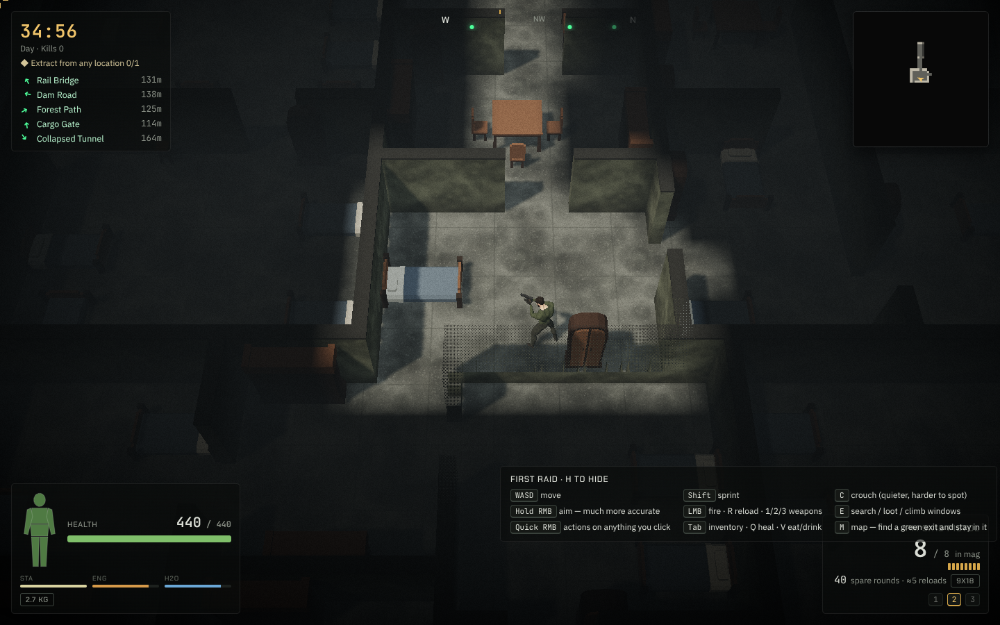
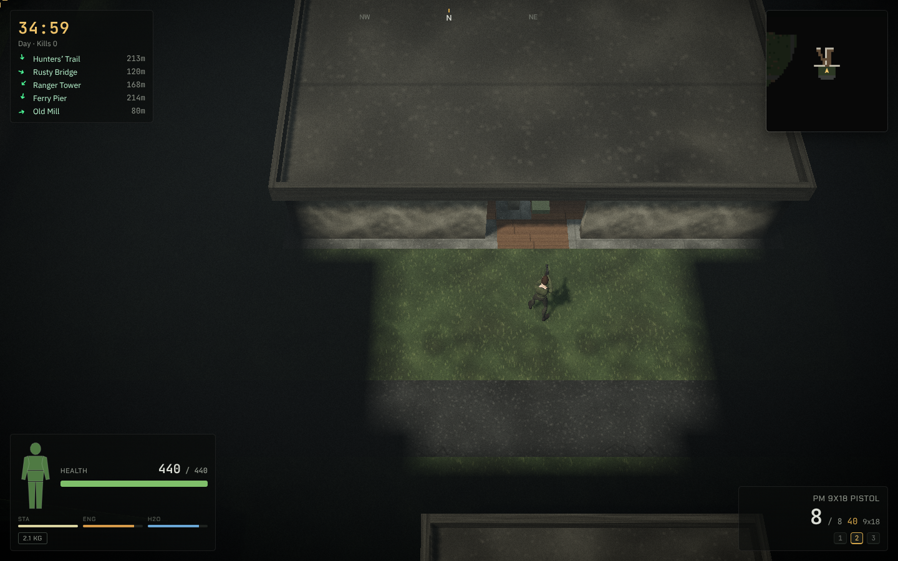
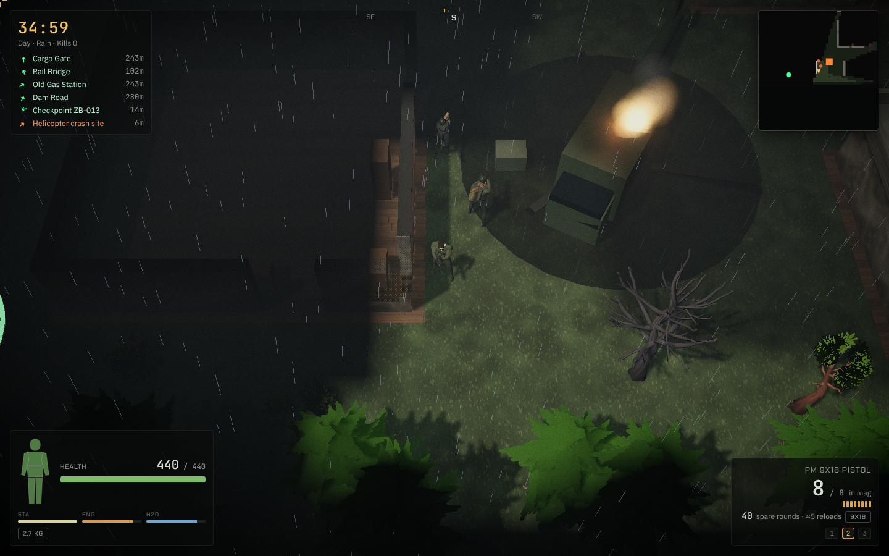
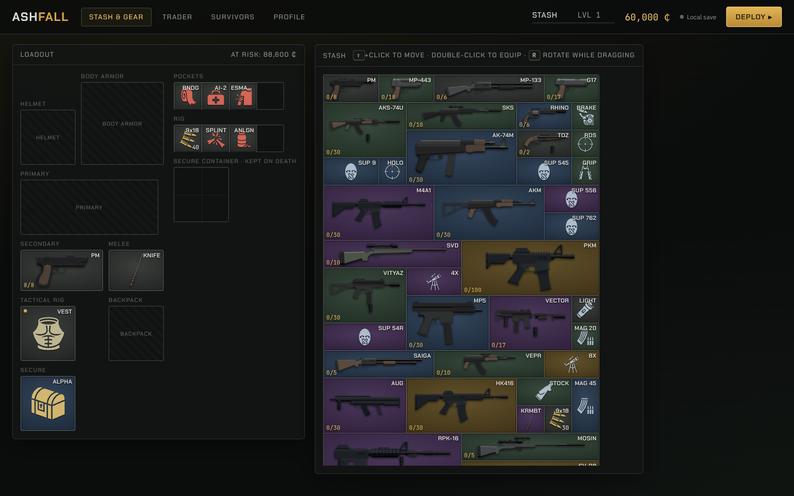
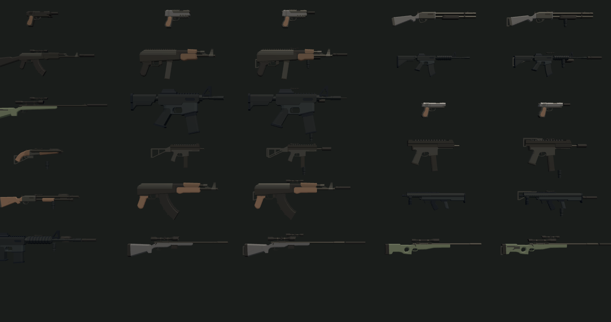
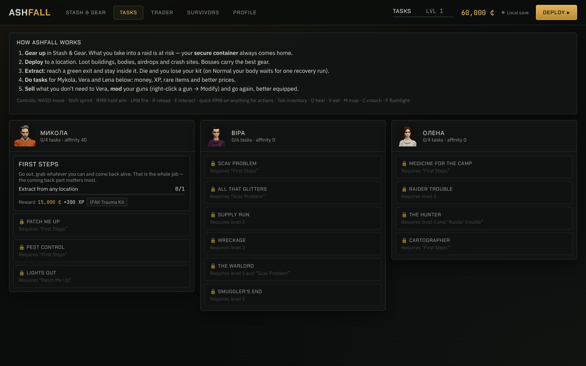
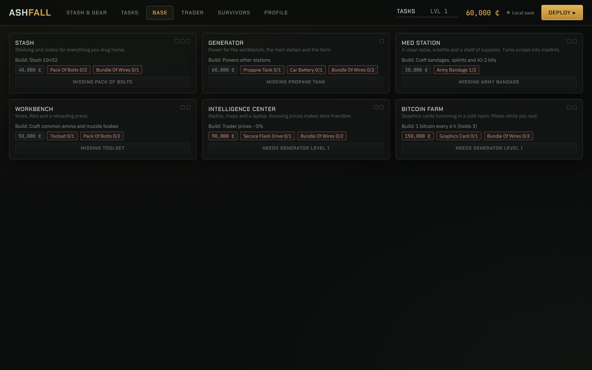

# Ashfall

A top-down extraction looter-shooter that runs in the browser and installs on macOS as an app.
It plays like Escape from Tarkov seen from above, with Project Zomboid's houses and Escape from Duckov's
pace. You drop into a post-Soviet town with a few items, loot buildings, fight scavs, raiders and
infected, and reach an exit before the timer runs out. If you die, everything you carried stays on the map.

**Play:** https://ashfall-two.vercel.app



| | |
|---|---|
|  |  |
|  |  |
|  |  |

## The loop

1. **Prepare** in the hideout: pick a kit from the stash, buy from Vera, mod your guns, and choose a map,
   time of day and difficulty.
2. **Raid**: loot containers (they reveal items one at a time), fight or sneak past bots, and look for
   airdrops, helicopter crashes and the three named bosses with their guards.
3. **Extract**: what you carry goes to the stash and is marked *found in raid*. If you die you lose
   everything except the **secure container**. On Easy and Normal your body waits on that map for one
   recovery raid.
4. **Progress**: hand found-in-raid items and kills to the NPC tasks (14 tasks), level up, and build base
   stations (generator, med station, workbench, intel center, bitcoin farm). Crafts and the farm run on
   real time, including while you are in a raid.

## Features

- Deterministic simulation in a separate engine package with a fixed timestep: maps, AI, ballistics,
  health and inventory. The renderer only reads it.
- Large generated maps (Zavadsk Outskirts, Pine Hollow, Port Kirov) with districts, furnished buildings,
  roofs that hide when you step inside, windows you can vault through or smash, and a line-of-sight
  fog of war.
- Tarkov-style health: seven body parts, bleeds, fractures, blacked-out limbs, pain and painkillers,
  energy and hydration.
- Bot AI with vision cones, light and motion detection, per-noise hearing, investigating, taking cover,
  strafing, healing and fleeing, and squads that move with their leader. Sneaking works: crouching in the dark keeps you hidden.
- 23 guns with real attachments (suppressors, scopes, grips, stocks, lights, brakes), weapon classes,
  and mods that change recoil, ergonomics, noise and range.
- Animated humans on one shared skeleton: male and female bodies, modelled faces, hairstyles and beards,
  outfits per faction, and vault, loot, eat and heal animations.
- Sampled, spatialised sound: per-calibre gunshots with distance tails, suppressed shots, surface-aware
  footsteps, reloads, impacts and weather ambience.
- Installable PWA that works offline. Saves live in IndexedDB and optionally sync across devices through
  the Go backend.

## Controls

| Key | Action |
|---|---|
| WASD / arrows | Move |
| Mouse | Aim and look (the light cone follows the cursor) |
| Hold RMB | Aim down sights (tighter spread) |
| Quick RMB | Context menu on whatever you click (walk here, search, open, vault…) |
| LMB | Fire / melee |
| Shift | Sprint |
| C | Crouch (quieter and harder to spot) |
| R | Reload |
| 1 / 2 / 3 | Primary / secondary / melee |
| E | Search, loot, talk, vault through a window |
| Tab or I | Inventory |
| Q | Quick heal (picks the right med for your worst injury) |
| V | Eat / drink |
| F | Flashlight |
| M | Map |
| Esc | Pause |
| F3 or ` | Performance overlay |

## Install on a Mac

The game is a PWA, so it runs in its own window, has a Dock icon and works offline.

- **Safari (macOS Sonoma or later):** open the site, then choose **File → Add to Dock**.
- **Chrome or Edge:** open the site, then click the install icon in the address bar (or use **⋮ → Cast,
  save and share → Install page as app**).

Updates download in the background and apply the next time you launch.

## Development

Requirements: Node 20 or later (22 recommended). Go 1.25 is needed only for the backend.

```bash
npm ci
```

```bash
npm run dev
```

The dev server is at http://localhost:5173. Useful scripts:

| Script | What it does |
|---|---|
| `npm run check` | Typecheck, lint, unit tests, production build |
| `npm test` | Vitest unit tests for the engine (and the web app) |
| `npm run bench` | Simulation benchmark (ticks per second on a full map) |
| `npm run e2e` | Playwright smoke tests: boot a raid, profile persistence, service worker |
| `npm run build` / `npm run preview` | Production build in `apps/web/dist` and a local preview |

CI (`.github/workflows/ci.yml`) runs lint, typecheck, unit tests, the benchmark and the build. It also
runs the Go tests against a real MongoDB and builds the server's Docker image, then runs the Playwright
end-to-end tests.

### Layout

```
packages/engine   @ashfall/engine: pure TypeScript simulation, no DOM or three.js
apps/web          Vite + React 19 + three.js client, PWA
server            Go + MongoDB backend (profile sync, raid history, leaderboard)
tools/assets      CC0 model packs → optimised GLBs (FBX/glTF → glTF-Transform + meshopt)
tools/sounds      CC0 recordings → trimmed, normalised MP3s + manifest
tools/icons       game-icons.net SVGs → inventory icon module
docs              Screenshots and design research (docs/research/escape-from-duckov.md)
```

### The engine as its own repository

`packages/engine` has no runtime dependencies, so it can be developed and versioned separately. To
publish it as a standalone repository and pull it back as a git submodule:

```bash
git subtree split --prefix=packages/engine -b engine-only
```

```bash
git push git@github.com:trusthemind/ashfall-engine.git engine-only:main
```

```bash
git rm -r packages/engine && git commit -m "Move engine to a submodule"
```

```bash
git submodule add git@github.com:trusthemind/ashfall-engine.git packages/engine
```

The npm workspace keeps working because the submodule sits at the same path with the same
`package.json`.

### Rebuilding assets

The generated files in `apps/web/public/models` and `apps/web/public/sfx` are committed, so you only need
this when you change the pipelines. Download the packs listed in the credits, extract them into one
folder, then:

```bash
ASSET_SRC=/path/to/packs node tools/assets/build.mjs
```

`ONLY=furniture,weapons` rebuilds just those sets.

## Backend (Go + MongoDB)

The backend is optional: without it the game is fully single-player and offline. With it, a profile
syncs across devices (optimistic concurrency on a revision number), you can move an account to another
device with an 8-character one-time code, and there is a global leaderboard.

| Method | Path | Notes |
|---|---|---|
| GET | `/api/v1/health` | `{ok, db}` where `db` is `mongo` or `memory` |
| POST | `/api/v1/players` | `{name}` → `{playerId, token, code}` |
| GET | `/api/v1/profile` | Bearer token → `{profile, rev}` |
| PUT | `/api/v1/profile` | `{profile, baseRev}` → `{rev}`, or 409 if another device saved first |
| GET | `/api/v1/players/me/code` | One-time link code, valid for 10 minutes |
| POST | `/api/v1/players/claim` | `{code}` → `{playerId, token}` for the new device |
| POST | `/api/v1/raids` | Raid result for history |
| GET | `/api/v1/leaderboard` | Top 50 by XP |

There are no passwords. Each device holds a random bearer token, and the server stores only its SHA-256.
Account creation and code claiming are rate-limited per IP.

Run it locally (without `MONGODB_URI` it keeps data in memory):

```bash
npm run server
```

```bash
cd server && go test ./...
```

Set `MONGODB_TEST_URI=mongodb://localhost:27017` to run the store tests against a real database too.

| Variable | Default | |
|---|---|---|
| `PORT` | `8080` | Railway sets this |
| `MONGODB_URI` | (none, in-memory) | Mongo connection string |
| `MONGODB_DB` | `ashfall` | Database name |
| `ALLOWED_ORIGINS` | any origin | Comma-separated CORS origins; `*.vercel.app` wildcards work |

### Deploying to Railway

1. Create a project and add a **MongoDB** service.
2. Add a service from this GitHub repo and set its **Root Directory** to `server`. Railway picks up
   `server/railway.json`, which builds the Dockerfile and health-checks `/api/v1/health`.
3. In that service's variables, set `MONGODB_URI` to `${{MongoDB.MONGO_URL}}` and `ALLOWED_ORIGINS` to
   `https://ashfall-two.vercel.app,*.vercel.app`.
4. Generate a public domain for the service.
5. In Vercel, set `VITE_API_URL` to that domain (for example `https://ashfall-api.up.railway.app`) and
   redeploy. The hideout's Stats tab then shows the leaderboard and device linking.

## Credits

All 3D models, animations, sounds and icons are free assets. Full lists are in
`apps/web/public/models/CREDITS.txt` and `apps/web/public/sfx/CREDITS.txt`.

- **Models and animation:** [Quaternius](https://quaternius.com) (CC0): Universal Animation Library 1 and 2,
  Universal Base Characters, Ultimate Gun Pack, Survival Pack, Stylized Nature MegaKit, Furniture Pack.
- **Sound:** OpenGameArt CC0 recordings, including The Free Firearm Sound Library (Jaszczak, Nelson,
  Heras, Nanney), footstep, reload, ambience and creature packs.
- **Icons:** [game-icons.net](https://game-icons.net) by Lorc, Delapouite, Skoll, sbed and contributors
  (CC BY 3.0).
- **Fonts:** Chakra Petch, IBM Plex Sans and JetBrains Mono (SIL Open Font License).
